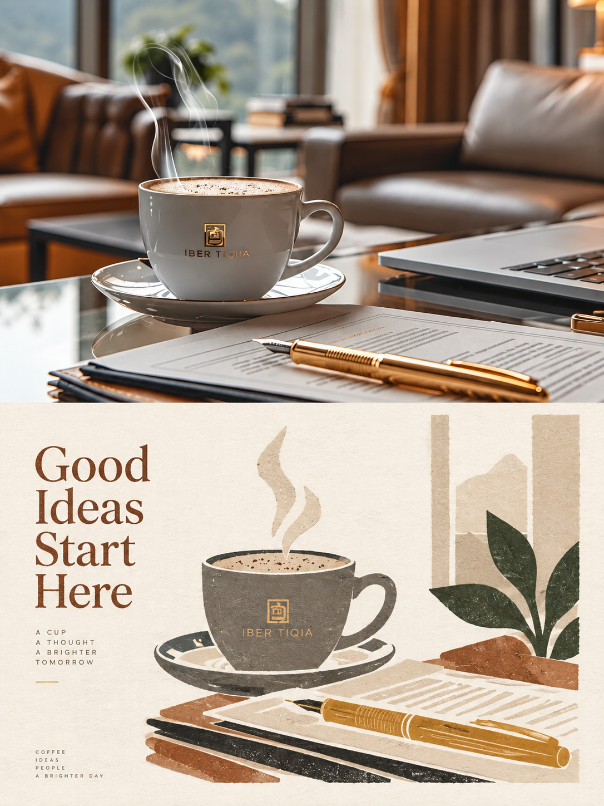
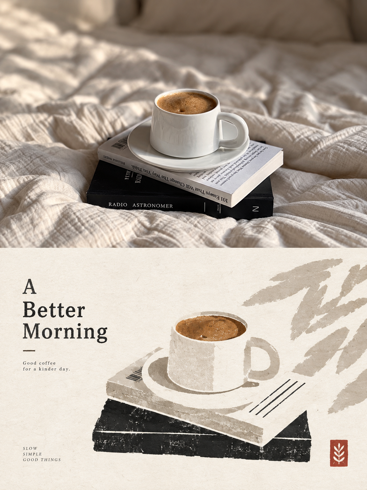
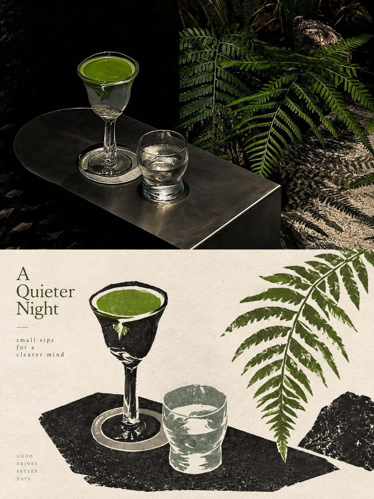
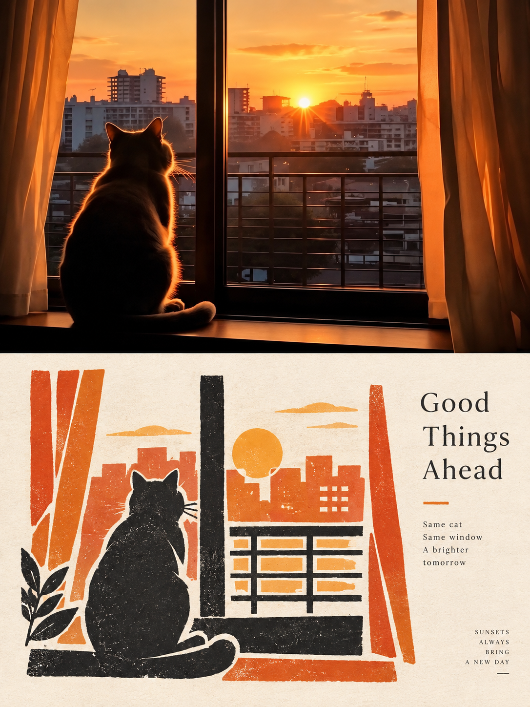
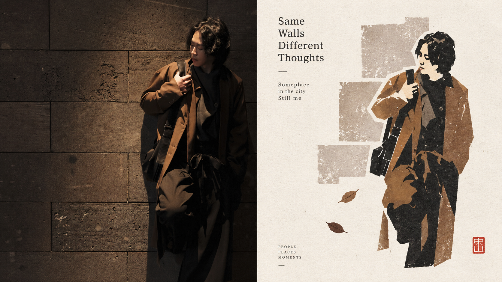
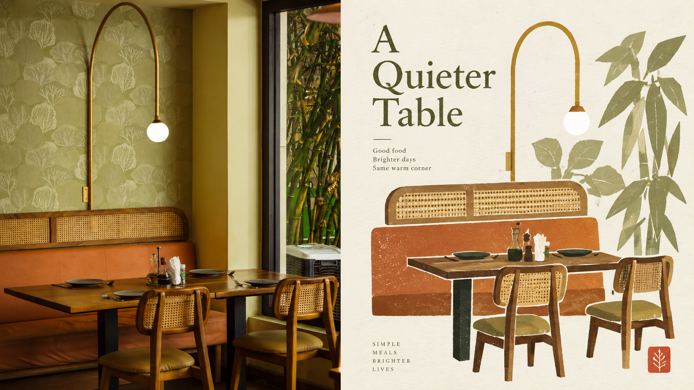

<div align="center">

# XXD Panel 108｜New Folk Paper-Cut Journal

**Cuts the most recognisable shapes of a photo into a quiet, folk-flavoured coloured-paper collage.**

<a href="README.md">简体中文</a> · <strong>English</strong> · <a href="README.ja.md">日本語</a> · <a href="README.ko.md">한국어</a> · <a href="README.ar.md">العربية</a>

</div>

<table>
  <tr>
    <td width="50%"></td>
    <td width="50%"></td>
  </tr>
</table>

<p align="center"><sub>Top: the original photo. Bottom: the same photo in this style.</sub></p>

## What it is

A Skill for AI agents such as Claude Code and Codex. Give it a photo and it paints a finished PNG following the original Panel 108 prompt.

- **What it looks like:** The subject is summed up as silhouettes, colour pieces, carved lines and positive and negative shapes, like separate sheets of coloured paper cut out and reassembled, a little naive, symbolic and geometric. It is kept small, like a seal mark, set off to one side, against an edge or partly cropped, inside wide off-white paper space with very few supporting elements. Edges show hand-cut wobble, slight misregistration, faded ink and print grain, with paper fibre visible. Only two to four colours from the photo are used, distinct but restrained. Text is small and light, such as a short title, a number or a colour reference, set in the whitespace or a corner, in any language.
- **Keywords:** Folk paper-cut collage · Symbolic outlines · Print grain · Two to four photo colours · Seal-like motif · Wide whitespace
- **What you can make:** A top–bottom comparison (photo above, design below), a left–right comparison, the design alone, or a wallpaper set for phone, tablet, desktop and watch. Pick several at once, at any ratio or exact pixel size.
- **What it is not:** Not a filter and not a template: every image is redrawn from your photo, and each photo is its own job.

## Get started in three steps

**1. Install.** Works with Claude Code, Codex and other agents that support Skills:

```bash
npx skills add https://github.com/nevertoday/xxd-panel-108 --skill xxd-panel-108
```

Then restart your agent session. You can also `git clone` this repository and link the folder to `~/.claude/skills/xxd-panel-108` or `~/.codex/skills/xxd-panel-108`.

**2. Make sure your agent can generate images.** This Skill has no image model of its own; it uses your agent's image generation, preferably GPT Image 2.

- Codex works as is when its built-in image generation is on.
- Claude Code and other agents without built-in image generation need an OpenAI-compatible image API. It takes about five minutes: see [Setting up image generation](#setting-up-image-generation).

Not sure? Just try it. If images can't be generated, the Skill stops and tells you before doing any work.

**3. Send a photo and say one sentence:**

> Use xxd-panel-108 to turn this photo into a 3:4 top–bottom poster with an English title.

If your request is complete, it starts right away; anything you left out (layout, ratio, text) it asks about, usually in one or two questions. Results are PNGs in a new folder under `~/Desktop/xxd/xxd-panel-108/`.

## Which photos work best

**Works well**

- Subjects with a strong outline that could be cut as one silhouette: a bird, a sprig of flowers, a pagoda, a cat
- Objects and buildings with cultural or local character: lanterns, a teapot, a memorial gate, an old house
- Photos you want as a cultural-goods pattern, seasonal poster, seal-style mark or book cover

**Not a good fit**

- Scenes where several subjects matter equally, since only one small focal motif remains
- Photos that need real perspective or rich detail: street panoramas, machinery, close-up portraits
- Requests for full-bleed illustration, cartoons, 3D or glossy vectors

## Samples

Each image below is a finished result this Skill made from one photo. The top–bottom and left–right sets use different photos.

### Top–bottom: photo above, design below

<table>
  <tr>
    <td width="50%"></td>
    <td width="50%"></td>
  </tr>
  <tr>
    <td width="50%"></td>
    <td width="50%"></td>
  </tr>
</table>

### Left–right: photo left, design right

<table>
  <tr>
    <td width="50%"></td>
    <td width="50%"></td>
  </tr>
  <tr>
    <td width="50%"></td>
    <td width="50%"></td>
  </tr>
</table>

## Just say it

No parameters to memorise. Say what you want:

| You want | Say |
|---|---|
| Top–bottom comparison | Make a 3:4 top–bottom comparison |
| Left–right comparison | Make a 16:9 left–right comparison, photo on the left |
| Design only | Just the design, no photo, 9:16 portrait |
| A wallpaper set | Make matching wallpapers for phone, tablet, desktop and watch |
| Several ratios | Make this one at 1:1, 3:4 and 16:9 |
| Your own text | Use the title “Let the wind pass through” exactly as written |
| No text | No text at all |
| Text language | Write the text in Japanese |
| A whole folder | Turn every photo in this folder into a top–bottom comparison |
| Same as last time | Use my settings from last time |

Prefer the command line? The flags map one to one:

```text
/xxd-panel-108 photo.jpg --mode top-bottom --size 3:4 --text prompt --locale en-US
/xxd-panel-108 photo.jpg --mode design-only --size 9:16 --text none
/xxd-panel-108 ./photos --mode left-right --size 16:9 --text prompt --locale ja-JP
```

All flags are listed under [Parameters](#parameters).

## FAQ

**Does the original photo have to appear?** No. Ask for “design only” or a wallpaper set and the whole canvas is design.

**Who writes the text?** By default the image model writes it from your photo; you only choose the language. Give your own words and they are used exactly; or ask for no text. Anything that looks factual (places, dates, numbers) comes only from you or from what is visible in the photo, never invented.

**What if I don't like the result?** Say “one more”. It redraws from the original photo instead of editing the last result, so every attempt is different.

**Do photos in a batch mix together?** No. Each photo is generated on its own and never borrows another photo's colours, text or layout. Settings are asked once for the whole batch.

**Where do my photos go?** Only to the image model your agent uses. The Skill uploads nothing elsewhere and never prints endpoints or keys.

**How does this relate to other Panels?** XXD Panels are a family of styles, one per number, fully independent; install only the ones you like. To have AI recommend a style for a photo, or compare several at once, use the catalog [xxd-panel-all](https://github.com/nevertoday/xxd-panel-all).

## Original prompt

This style is defined entirely by Xiaoxiaodong's [original prompt](references/original-prompt/zh-CN.md) (in Chinese). The Skill only appends the layout, size and text settings you choose; it never summarises, translates or rewrites the prompt.

Reading translations (for reading only; never sent to the image model): [English](references/original-prompt/en.md) · [日本語](references/original-prompt/ja.md) · [한국어](references/original-prompt/ko.md) · [العربية](references/original-prompt/ar.md)

## Setting up image generation

You need an OpenAI-compatible API that serves `gpt-image-2` (or a compatible model) and its API key. This creates a separate config and leaves your Codex settings alone:

```bash
mkdir -p ~/.xxd-imagegen
cat > ~/.xxd-imagegen/config.toml <<'EOF'
model_provider = "image"

[model_providers.image]
base_url = "https://api.openai.com/v1"   # or your compatible endpoint
env_key = "XXD_IMAGE_API_KEY"
EOF

# add to ~/.zshrc or ~/.bashrc so your agent can read them
echo 'export XXD_IMAGEGEN_CODEX_DIR=~/.xxd-imagegen' >> ~/.zshrc
echo 'export XXD_IMAGE_API_KEY=your-key' >> ~/.zshrc
```

Reopen your terminal and agent, then check once from this Skill's folder:

```bash
python3 scripts/configured_imagegen.py probe
```

`"ok":true` means it works. The check only reports readiness; it never prints the endpoint or key. If your Codex already generates images through a compatible API, skip this step.

## Parameters

| Flag | Values |
|---|---|
| `--mode` | `top-bottom` · `left-right` · `design-only` · `wallpaper-pack` (phone, tablet, desktop, watch); combine freely |
| `--size` | `auto` recommended · `source` match the photo · `1:1` `3:4` `4:3` `4:5` `5:4` `2:3` `3:2` `9:16` `16:9` `21:9` `5:7` `7:5` · exact pixels such as `2160x3840`; combine freely |
| `--text` | `prompt` written from the photo · `exact` your words (with `--copy "…"`) · `none` no text |
| `--locale` | text language, e.g. `zh-CN` `en-US` `ja-JP` `ko-KR` `ar` |
| `--wallpaper` | `linked` a matching set · `independent` four separate designs |
| `--wallpaper-size` | device pixels, e.g. `phone=1440x3200,desktop=3840x2160` |
| `--out` | another output root (default `~/Desktop/xxd/xxd-panel-108/`) |
| `--prefs` | `last` reuse · `edit` start from last time · `new` choose again · `off` don't remember this time · `clear` forget |

- With every value given, nothing is asked; otherwise only the missing values are. Pass a folder instead of `photo.jpg` to batch.
- Combinations are generated one by one: 2 modes × 3 sizes = 6 images, each composed for its own canvas rather than cropped.
- Comparisons are exactly 50:50. Usually the model paints only the design half and a script places the untouched photo beside it, so the split is centred and the photo is unchanged.
- Files are named like `source-001-street-top-bottom-3x4-1152x1536.png`, all in one flat task folder.
- Only layout, size, text mode and language are remembered, never photos, copy or keys.

<!-- xxd-readme-ads:start -->
## About XXD

XXD is Xiaoxiaodong's abbreviated brand name. This project is created and maintained by [@xiaoxiaodong01](https://x.com/xiaoxiaodong01).

## Xiaoxiaodong multi-platform membership · CNY 699/year

> **Advertising disclosure:** The QR code, membership, and paid-service links below are XXD promotional information. Scanning or purchasing is entirely optional and does not affect access to this open-source project.

One annual membership unlocks three benefits together: **Knowledge Planet + the XXD Member Prompt Library + membership for all General Skills**. They are included in one membership; no separate purchase is required.

<!-- xxd-panel-command-system:start -->

### How the Skills work together

| Level | Included | What it does |
|---|---|---|
| **General** | [`xxd-panel-all`](https://github.com/xiaoxiaodong-ai/xxd-panel-all) | Detects available numbered Skills, recommends them by image, theme, or use, and organizes multi-style and batch tasks. |
| **Soldier** | `xxd-panel-NNN` | Each numbered Skill follows its own original brief and aesthetic to complete the specific task assigned by the General. |

<!-- xxd-panel-command-system:end -->

### What you receive

1. **One-to-one WeChat AI learning and project support**
   Add Xiaoxiaodong on WeChat via the QR code below to discuss AI learning, tools, and real projects one to one, with practical guidance and answers. Representative questions may be organized into member resources.
2. **A growing member prompt library**
   The [XXD Member Prompt Library](https://vip.xiaoxiaodong.ai/) currently contains about 32,000 prompts and will keep expanding, with a goal of exceeding 100,000.
3. **All General Skills and usage support**
   One membership covers every General Skill, with usage guidance and Q&A when you need help.
4. **Priority for high-need requests**
   Frequently requested, high-need prompts and Skills are reviewed and developed first where appropriate.

### How to join

- [Activate membership on the member website](https://vip.xiaoxiaodong.ai/).
- Or scan the QR code below to add Xiaoxiaodong on WeChat for one-to-one activation support.

<p align="center"><a href="https://xiaoxiaodong.pages.dev/assets/wechat-qr.png"></a></p>
<!-- xxd-readme-ads:end -->

## License

This project is released under the **PolyForm Noncommercial License 1.0.0**. See [LICENSE](LICENSE) for the complete legal text and <https://polyformproject.org/licenses/noncommercial/1.0.0> for the official page.

- Personal study, research, experiments, testing, hobbies, private entertainment, and the noncommercial organisations defined by the license are permitted.
- For noncommercial purposes you may use, copy, modify, create derivative works, and distribute, provided you include the license and every `Required Notice:` supplied by the author.
- Commercial products or services, paid delivery, selling access, and anticipated commercial applications are prohibited; obtain separate written permission for commercial use.
- Only the stated copyright and limited patent rights are granted. No trademark or other unstated rights are granted, and you may not sublicense or transfer the license.
- After written notice of a violation, correct it within 32 days or the licenses end. The project is provided as is, without warranties.
